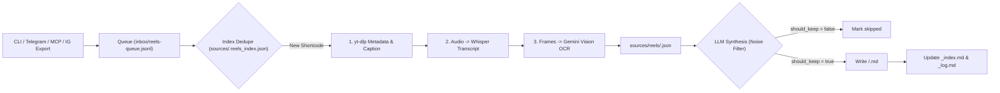

<p align="center">
  
</p>

# reels-wiki

[](https://github.com/AtaCanYmc/reels-wiki/actions/workflows/ci.yml)
[](https://github.com/AtaCanYmc/reels-wiki/actions/workflows/release-please.yml)
[](https://github.com/AtaCanYmc/reels-wiki/actions/workflows/pages.yml)
[](https://github.com/AtaCanYmc/reels-wiki/releases)
[](https://pypi.org/project/reels-wiki/)
[](https://www.python.org/downloads/)
[](LICENSE)
[](https://github.com/AtaCanYmc/homebrew-tap)

Local-first pipeline that converts saved Instagram Reels into atomic Markdown notes inside an existing 3-layer Obsidian LLM Wiki vault without duplicates.

Available interfaces: Python SDK (`reels_wiki`), CLI (`reels-sync`), MCP server (`reels-wiki-mcp`), Telegram capture bot (`reels-wiki-telegram`), and Agent Skill (`SKILL.md`).

## Table of Contents

- [Quick Start (Docker)](#quick-start-docker)
- [Quick Start (Local)](#quick-start-local)
- [Usage](#usage)
- [How It Works](#how-it-works)
- [Repository Layout](#repository-layout)
- [Documentation and Governance](#documentation-and-governance)
- [Notes and Limits](#notes-and-limits)

## Quick Start (Docker)

```bash
cp config.example.yaml config.yaml && cp .env.example .env
docker compose build
docker compose run --rm reels-process
docker compose up -d reels-telegram
```

## Quick Start (Local)

Prerequisites: Python 3.10 or newer and `ffmpeg` on your `PATH`. `ffmpeg` is only required when audio or frame fallbacks run.

### Step 1: Clone and install

```bash
git clone https://github.com/AtaCanYmc/reels-secretary.git
cd reels-secretary
python3 -m venv .venv
source .venv/bin/activate
pip install -e ".[dev]"
```

To enable offline audio transcription with `faster-whisper`, include the `local` extra:

```bash
pip install -e ".[dev,local]"
```

### Step 2: Configure your vault path and credentials

Run the interactive setup wizard to generate `config.yaml` and `.env`, then run diagnostics automatically:

```bash
reels-sync init
```

Or copy the example configuration manually and set `vault_path` to your Obsidian LLM Wiki root directory:

```bash
cp config.example.yaml config.yaml
```

`reels-wiki` searches for configuration files in this order:

1. `--config <path>` CLI flag
2. `$REELS_WIKI_CONFIG` environment variable
3. `./config.yaml` in the current working directory
4. `~/.config/reels-wiki/config.yaml`

You can override `vault_path` at runtime with `--vault <path>` or `$REELS_WIKI_VAULT`. Unknown keys in `config.yaml` are rejected on load to catch typos early.

### Step 3: Add API keys in `.env`

Create a `.env` file in the project root with your provider credentials:

```env
GROQ_API_KEY=your_groq_api_key
GEMINI_API_KEY=your_gemini_api_key

# Optional: only required for the Telegram capture bot
TELEGRAM_BOT_TOKEN=your_telegram_bot_token
TELEGRAM_ALLOWED_CHAT_ID=123456789
```

### Step 4: Set up Instagram authentication

Instagram blocks anonymous scraping. Choose one authentication method under the `extraction:` section in `config.yaml`:

- `cookies_from_browser: chrome`: reads your active browser session via `yt-dlp`. Also supports `firefox` or profile syntax such as `"chrome:Profile 1"`.
- `cookies_file: ~/cookies.txt`: reads a Netscape-format cookie export file.

Keep `delay_seconds` at `2.0` or higher, process items in small batches, and keep `yt-dlp` updated with `pip install -U yt-dlp`.

### Step 5: Verify the installation

Run the queue statistics command to verify configuration loading and vault access:

```bash
reels-sync stats
```

## Usage

### 1. Enqueue a single Reel

```bash
reels-sync ingest "https://www.instagram.com/reel/DAbCdEfGhIj/?igsh=xyz"
```

Duplicate shortcodes are skipped automatically unless `--force` is passed.

### 2. Import an Instagram data export

1. Open Instagram and go to **Accounts Center > Your information and permissions > Export your information**.
2. Select **JSON** format and include **Saved** items.
3. Pass the downloaded folder or `saved_posts.json` file to the importer:

```bash
reels-sync import-ig ~/Downloads/instagram-export/
```

### 3. Process the queue

Preview pending items before spending LLM or transcription calls:

```bash
reels-sync process --dry-run
```

Run extraction, synthesis, and note writing in batches:

```bash
reels-sync process --limit 10
```

Retry previously failed items:

```bash
reels-sync process --retry-failed
```

### 4. Reprocess stored artifacts

Re-run LLM synthesis from the saved `sources/reels/<shortcode>.json` artifact without downloading media or running Whisper again:

```bash
reels-sync reprocess DAbCdEfGhIj
reels-sync reprocess --all
```

### 5. Inspect queue statistics

```bash
reels-sync stats
reels-sync --json stats
```

When using `--json`, global flags must appear before the subcommand.

### Telegram Capture Bot

1. Create a bot via `@BotFather` and retrieve your numeric chat ID via `@userinfobot`.
2. Set `TELEGRAM_BOT_TOKEN` and `TELEGRAM_ALLOWED_CHAT_ID` in `.env`.
3. Start the long-polling listener:

```bash
reels-sync telegram
```

Share a Reel to your bot from the Instagram mobile app. The bot rejects all other chat IDs and refuses to start without `TELEGRAM_ALLOWED_CHAT_ID`. It only enqueues URLs; schedule `reels-sync process` via cron or `launchd` to digest the queue.

### MCP Server

Add the server to your MCP client configuration:

```json
{
  "mcpServers": {
    "reels-wiki": {
      "command": "/path/to/reels-secretary/.venv/bin/reels-wiki-mcp",
      "env": {
        "REELS_WIKI_CONFIG": "/path/to/reels-secretary/config.yaml"
      }
    }
  }
}
```

Exposed MCP tools: `enqueue_reel`, `import_ig_export`, `process_reels_queue`, `get_queue_stats`, `reprocess_reel`, `search_vault_notes`.

### Python SDK

```python
from reels_wiki import enqueue, load_config, process_queue

cfg = load_config()
enqueue("https://www.instagram.com/reel/DAbCdEfGhIj/", "script", vault=cfg.vault_path)
process_queue(cfg, limit=3)
```

## How It Works



### Step 1: URL normalization and deduplication

Every incoming URL variant (`/reel/`, `/reels/`, `/p/`, `/tv/`, optional `/<user>/`, and tracking query parameters) is reduced to its 11-character shortcode and normalized to `https://www.instagram.com/reel/<shortcode>/`.

`sources/.reels_index.json` acts as an O(1) lookup gate mapping each shortcode to `{status, url, note_path, updated_at}`. The queue at `inbox/reels-queue.jsonl` is append-only, where the last snapshot per shortcode determines the current state. If the index is lost or corrupted, it is rebuilt from the queue. All writes are atomic and guarded by a file lock. Items left in `processing` after a crash are automatically reset on the next run. A forced re-run reuses the existing `note_path` and preserves user edits to `status` and `created` frontmatter fields.

### Step 2: Cost-aware 3-stage waterfall extraction

1. **Metadata**: Calls `yt_dlp` Python API with `extract_info(download=False)` to retrieve the caption, creator, duration, upload date, and subtitles.
2. **Audio transcription**: Runs only when the caption is shorter than `min_caption_chars` (default `150`) and no usable subtitles exist. Audio is downloaded to a temporary directory and transcribed with Groq `whisper-large-v3-turbo` or local `faster-whisper`.
3. **Frame OCR**: Runs only when both caption and transcript fall below `min_caption_chars` and `min_transcript_chars` (default `40`). `vision_frames` (default `4`) evenly spaced frames are extracted via `ffmpeg` and read with `gemini-2.5-flash`.

Failures in any stage are recorded in the artifact `warnings` list instead of aborting the pipeline. Reels with zero extracted text are marked `skipped` without spending an LLM synthesis call. Extracted payloads are stored in `sources/reels/<shortcode>.json`. No media files are saved inside the vault.

### Step 3: Vault discovery and strict enforcement

Before synthesis, `reels-wiki` reads the vault to discover allowed folders from backticked folder tokens in `_CLAUDE.md` and `_index.md`, existing `#tags`, and existing note titles. `sources/` and `inbox/` are excluded as output destinations. You can override discovery with `allowed_folders` in `config.yaml`.

Model output is validated before writing:

- Invalid folders fall back to `default_folder`.
- File slugs are transliterated to ASCII (including Turkish characters).
- Tags are normalized against the vault taxonomy.
- `related_wikilinks` that do not match an existing note are rendered as plain text `(new note candidate) ...` to prevent broken links.
- Notes are written atomically inside the vault path using `python-frontmatter`.
- `_index.md` entries are inserted idempotently under the matching folder heading, and `_log.md` entries match the file's existing format.

### Step 4: Noise filtering and retries

The `AtomicNoteSynthesis` schema includes a `should_keep` boolean. Memes, trends, and low-signal posts are marked `skipped` with `skip_reason` stored in the index. Malformed JSON responses trigger repair retries and then fall back to `fallback_provider` if configured.

## Repository Layout

```text
reels-secretary/
├── assets/
│   └── logo.png
├── docs/
│   ├── README.md
│   ├── architecture.md
│   ├── cli-and-mcp.md
│   ├── configuration.md
│   ├── deployment.md
│   ├── example-walkthrough.md
│   ├── providers.md
│   ├── saved-posts-workflow.md
│   ├── shortcuts-and-extension.md
│   ├── step-by-step.md
│   ├── telegram-bot.md
│   └── troubleshooting.md
├── src/
│   └── reels_wiki/
│       ├── __init__.py
│       ├── core/
│       │   ├── __init__.py
│       │   ├── config.py
│       │   ├── models.py
│       │   └── utils.py
│       ├── ingestion/
│       │   ├── __init__.py
│       │   ├── ig_export.py
│       │   └── queue_manager.py
│       ├── interfaces/
│       │   ├── __init__.py
│       │   ├── cli.py
│       │   ├── cli_ui.py
│       │   ├── http_server.py
│       │   ├── mcp_server.py
│       │   └── telegram_bot.py
│       ├── pipeline/
│       │   ├── __init__.py
│       │   ├── extractor.py
│       │   ├── runner.py
│       │   └── synthesizer.py
│       ├── prompts/
│       │   ├── __init__.py
│       │   ├── synthesis_system.j2
│       │   ├── synthesis_user.j2
│       │   └── vision_ocr.j2
│       └── vault/
│           ├── __init__.py
│           ├── context.py
│           └── writer.py
├── extension/
│   ├── icons/
│   ├── background.js
│   ├── manifest.json
│   ├── popup.css
│   ├── popup.html
│   └── popup.js
├── site/
│   ├── favicon.ico
│   ├── favicon.png
│   ├── index.css
│   ├── index.html
│   ├── index.js
│   ├── llms.txt
│   ├── robots.txt
│   └── sitemap.xml
├── tests/
│   ├── test_cli.py
│   ├── test_extractor.py
│   ├── test_http_server.py
│   ├── test_ig_export.py
│   ├── test_mcp_server.py
│   ├── test_pipeline.py
│   ├── test_queue_manager.py
│   ├── test_synthesizer.py
│   ├── test_telegram_bot.py
│   └── test_writer.py
├── config.example.yaml
├── docker-compose.yml
├── Dockerfile
├── Makefile
├── pyproject.toml
└── SKILL.md
```

Tests run offline via `make test` (`pytest`) without making network or LLM API calls.

## Documentation and Governance

- [Architecture Guide](docs/architecture.md)
- [Step-by-Step Guide](docs/step-by-step.md)
- [Saved Posts Workflow](docs/saved-posts-workflow.md)
- [Telegram Bot Setup](docs/telegram-bot.md)
- [Deployment and Scheduling](docs/deployment.md)
- [Apple Shortcuts & Browser Extension](docs/shortcuts-and-extension.md)
- [Example Walkthrough](docs/example-walkthrough.md)
- [CLI and MCP Reference](docs/cli-and-mcp.md)
- [Configuration Reference](docs/configuration.md)
- [Providers Guide](docs/providers.md)
- [Troubleshooting Guide](docs/troubleshooting.md)
- [Contributing Guide](CONTRIBUTING.md)
- [Security Policy](SECURITY.md)
- [Roadmap](ROADMAP.md)
- [MIT License](LICENSE)

## Notes and Limits

- Shortcodes are validated as exactly 11 characters (`[A-Za-z0-9_-]`). Instagram `/share/...` redirect links are resolved automatically via HTTP redirects before shortcode extraction.
- Carousel and image-only photo posts (`/p/`) are accepted: when `yt-dlp` finds no video stream, downloaded carousel/thumbnail frames are routed to Gemini Vision OCR. Use `import-ig --reels-only` to skip `/p/` posts during bulk import.
- Note titles are generated in Turkish for Turkish content and technical English otherwise.
- Offline synthesis is supported via `synthesis.provider: ollama` against any OpenAI-compatible local endpoint (`http://localhost:11434/v1`), requiring no cloud API keys when paired with `whisper_provider: local`.
- Provider integrations for Groq, Google GenAI, and `yt-dlp` are isolated in `extractor.py` and `synthesizer.py` so upstream SDK changes only require edits in those two files.
