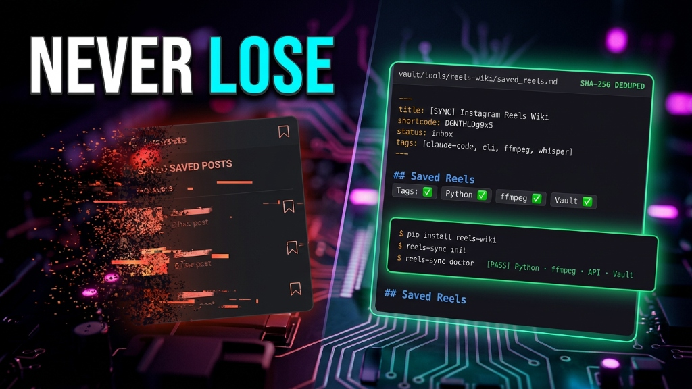
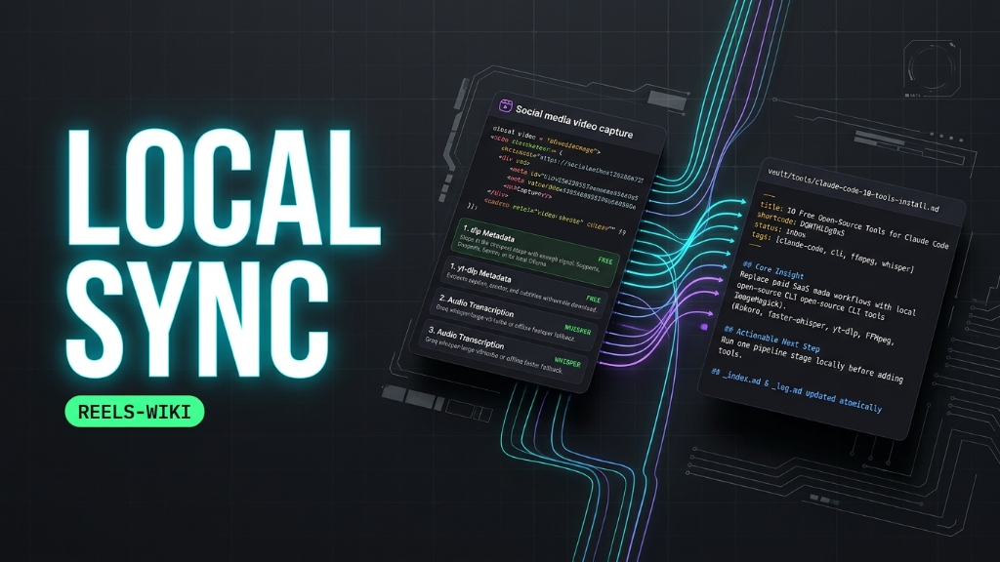
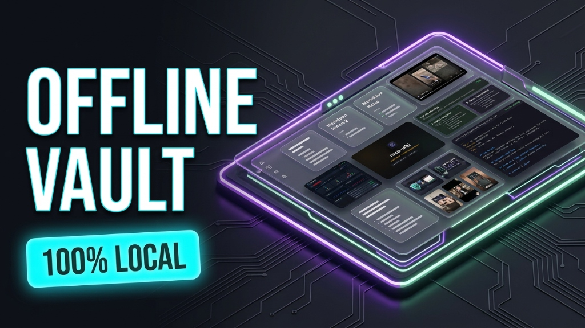

[Back to Repository Root](../README.md)

# Documentation

Technical reference and operational guides for `reels-wiki`.

| Document | Scope |
| :--- | :--- |
| [Step-by-Step Guide](step-by-step.md) | End-to-end lifecycle from installation and deduplication through synthesis and vault writes |
| [Saved Posts Workflow](saved-posts-workflow.md) | Official Instagram JSON export backfill and Telegram bot workflow for saved posts |
| [Telegram Bot Setup](telegram-bot.md) | Creating a bot with `@BotFather`, retrieving chat IDs, and running `reels-sync telegram` |
| [Deployment and Scheduling](deployment.md) | Docker Compose, macOS `launchd`, Linux `systemd`, package installs, and custom templates |
| [Apple Shortcuts & Browser Extension](shortcuts-and-extension.md) | Direct HTTP capture via `reels-sync serve`, Shortcuts, Chrome/Firefox/Safari extension, `obsidian-plugin/`, and `bruno/` tests |
| [Architecture Guide](architecture.md) | Data flow, queue invariants, 3-stage extraction waterfall, and vault context rules |
| [CLI and MCP Reference](cli-and-mcp.md) | `reels-sync` flags, subcommands, Rich/JSON output modes, and `reels-wiki-mcp` tools |
| [Search, Curation & Digests](search-and-curation.md) | Hybrid search (`sources/.embeddings.sqlite`), `reels-sync review`, topic digests, backlinks, and `--workers` |
| [Configuration Reference](configuration.md) | Config file lookup order, `.env` variables, extraction settings, and synthesis options |
| [Providers Guide](providers.md) | Obtaining API keys and discovering models for Groq, Google Gemini, and Ollama |
| [Migration Policy](migration.md) | Frozen v1 schemas, deprecation policy, upgrade steps, and queue/index recovery |
| [Example Walkthrough](example-walkthrough.md) | Real Instagram Reel, YouTube Shorts, and TikTok extraction traces (`Df44o7WhunQ`, `Df2jr_RN9gb`, `DdYn6ekug5W`, `DgNTHLDg9X5`, `yt_VpW4T7e34EI`, `tt_7684682826159049991`) |
| [Troubleshooting Guide](troubleshooting.md) | Diagnostics (`reels-sync doctor`), cookie expiration, `yt-dlp` updates, and lock recovery |

## Demo Video

| Local Sync Pipeline | Offline Obsidian Vault |
| :---: | :---: |
|  |  |
