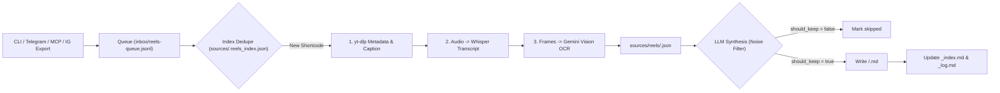

# Architecture

`reels-wiki` is a local-first pipeline that ingests saved Instagram Reel URLs, extracts text through a 3-stage waterfall, synthesizes atomic notes via LLM, and updates an Obsidian LLM Wiki vault.

## Data Flow

## Vault Layout

| Path | Purpose |
| :--- | :--- |
| `inbox/reels-queue.jsonl` | Append-only queue of ingested Instagram URLs |
| `sources/.reels_index.json` | Shortcode-keyed state index (`pending`, `processing`, `processed`, `skipped`, `failed`) |
| `sources/reels/<code>.json` | Raw extracted metadata, caption, transcript, and vision notes |
| `<folder>/<slug>.md` | Synthesized atomic Markdown note with YAML frontmatter |
| `_index.md` | Idempotent vault index updated on each kept note |
| `_log.md` | Append-only processing log |
| `_CLAUDE.md` | Vault-level conventions, allowed folders, and tag rules |

## Design Guarantees

- **Shortcode Deduplication**: Every `/reel/`, `/reels/`, `/p/`, and `/tv/` URL normalizes to an 11-character shortcode and canonical `https://www.instagram.com/reel/<shortcode>/`.
- **No Media Stored**: Downloaded audio and video frames are deleted after extraction; only `sources/reels/<code>.json` persists.
- **Re-synthesizable Artifacts**: `reels-sync reprocess` re-runs LLM synthesis from `sources/reels/<code>.json` without re-downloading media.
