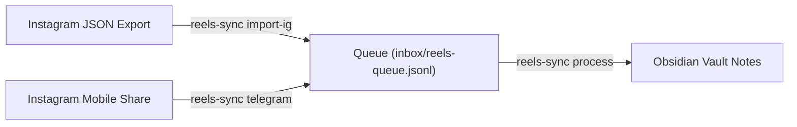

[Back to Documentation](README.md)

# Saved Posts Workflow

Recommended workflow for backfilling your existing Instagram Saved items and capturing new ones continuously without risking account checkpoints or rate-limit blocks.

## Overview

Instagram does not expose an official API for personal Saved collections, and `yt-dlp` does not support scraping `/saved/` pages directly. Scraping private web endpoints frequently triggers login challenges or account restrictions.

To keep your account safe while automating your Obsidian knowledge base, split capture into two zero-risk phases:

1. **Backfill existing saves**: Export your official Instagram data archive in JSON format and bulk-enqueue it with `reels-sync import-ig`.
2. **Capture new saves**: Share Reels directly from the Instagram mobile app to your private Telegram capture bot (`reels-sync telegram`).



---

## 1. Backfill Existing Saved Posts (Instagram Data Export)

### Export your data from Instagram

1. Open Instagram and navigate to **Accounts Center > Your information and permissions > Export your information**.
2. Choose **Download or transfer information** and select your Instagram account.
3. Select **Some of your information** and check **Saved** (or export all if preferred).
4. Set the format to **JSON** (not HTML) and create the files.
5. Download and unzip the archive once Instagram notifies you it is ready.

### Import into the queue

Pass either the unzipped export directory or the `saved_posts.json` file directly to `reels-sync import-ig`:

```bash
reels-sync import-ig ~/Downloads/instagram-export/
```

Common `import-ig` options:

| Flag | Placement | Effect |
| :--- | :--- | :--- |
| `--reels-only` | After `import-ig` | Skip `/p/` photo and carousel posts and import only `/reel/` or `/reels/` links |
| `--force` | After `import-ig` | Re-enqueue shortcodes that already exist in `sources/.reels_index.json` |
| `--json` | Before `import-ig` | Emit machine-readable JSON output |

### How deduplication works

During import, `src/reels_wiki/ig_export.py` reads `saved_posts.json`, extracts links via `string_map_data -> "Saved on" -> href` (falling back to nested `href` fields), and normalizes each URL to its 11-character Instagram shortcode. Any shortcode already present in `sources/.reels_index.json` is skipped unless `--force` is passed. New items are appended to `inbox/reels-queue.jsonl` with `source="ig_export"`.

---

## 2. Process the Backfill Safely in Batches

Avoid processing hundreds of saved posts in a single run. Keep `delay_seconds` at `2.0` or higher in `config.yaml` and work through the queue in small batches:

```bash
reels-sync process --dry-run
reels-sync process --limit 10
reels-sync stats
reels-sync process --retry-failed
```

| Command / Flag | Purpose |
| :--- | :--- |
| `reels-sync process --dry-run` | Preview pending items without downloading media or spending API tokens |
| `reels-sync process --limit 10` | Process a controlled batch of up to 10 items |
| `reels-sync stats` | Display queue and index breakdown (prefix `--json` for JSON output) |
| `reels-sync process --retry-failed` | Re-run items that failed due to temporary network or rate-limit errors |

---

## 3. Ongoing Capture (Telegram Bot)

For new Reels you discover day-to-day, use the built-in Telegram capture bot instead of waiting for another data export.

### Setup

1. Create a bot with `@BotFather` on Telegram and copy the bot token.
2. Retrieve your numeric Telegram user/chat ID using `@userinfobot`.
3. Add both credentials to `.env` in the project root:

   ```env
   TELEGRAM_BOT_TOKEN=your_telegram_bot_token
   TELEGRAM_ALLOWED_CHAT_ID=123456789
   ```

### Run and share

Start the long-polling bot listener:

```bash
reels-sync telegram
```

When you see a Reel worth keeping in the Instagram app, tap **Share** and send it to your Telegram bot. The bot verifies `TELEGRAM_ALLOWED_CHAT_ID`, extracts and deduplicates the shortcode, and appends it to `inbox/reels-queue.jsonl`.

> **Note:** `reels-sync telegram` only enqueues URLs. Pair it with periodic `reels-sync process --limit 10` runs (manually, via `cron`, or via macOS `launchd`) to extract, synthesize, and write notes into your vault.

---

## 4. Health Checks and Best Practices

- **Validate your setup** before large batch runs:

  ```bash
  reels-sync doctor
  ```

  This checks your Python version, `ffmpeg`, cookie configuration (`cookies_from_browser` or `cookies_file`), API keys, and vault write permissions.

- **Keep `yt-dlp` up to date**: Instagram frequently updates its web responses. Update `yt-dlp` regularly if metadata extraction begins failing:

  ```bash
  make update-yt-dlp
  ```
