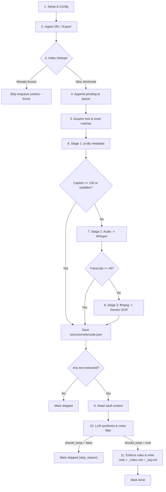

# Step-by-Step Guide

End-to-end walkthrough of every action, decision gate, and file mutation from initial installation to final Obsidian note creation.



## Step 1: Environment and Installation

1. Verify Python 3.10 or newer is installed and `ffmpeg` is available on `PATH` (used only for audio and frame fallbacks).
2. Clone the repository and install dependencies in a virtual environment:

```bash
git clone https://github.com/AtaCanYmc/reels-secretary.git
cd reels-secretary
python3 -m venv .venv
source .venv/bin/activate
pip install -e ".[dev]"
```

Optional: install `.[dev,local]` if you want offline transcription via `faster-whisper`.

## Step 2: Configuration and Credentials

1. Copy the example configuration file:

```bash
cp config.example.yaml config.yaml
```

2. Set `vault_path` to your Obsidian LLM Wiki root directory.
3. Configure one Instagram session source under `extraction:`:
   - `cookies_from_browser: chrome` (or `firefox`, `"chrome:Profile 1"`)
   - `cookies_file: ~/cookies.txt` (Netscape export format)
4. Create `.env` in the repository root with provider credentials:

```env
GROQ_API_KEY=your_groq_api_key
GEMINI_API_KEY=your_gemini_api_key

# Optional for Telegram bot:
TELEGRAM_BOT_TOKEN=your_telegram_bot_token
TELEGRAM_ALLOWED_CHAT_ID=123456789
```

Config lookup order at runtime: `--config <path>`, `$REELS_WIKI_CONFIG`, `./config.yaml`, then `~/.config/reels-wiki/config.yaml`. Unknown keys in `config.yaml` fail immediately on load.

## Step 3: Ingestion (Enqueue and Deduplicate)

Queue Reels using any input surface:

- **Single URL**: `reels-sync ingest "https://www.instagram.com/reel/DAbCdEfGhIj/?igsh=xyz"`
- **Instagram Data Export**: `reels-sync import-ig ~/Downloads/instagram-export/` (supports `saved_posts.json` or its parent folder; pass `--reels-only` to skip `/p/` posts)
- **Telegram Bot**: `reels-sync telegram` (accepts shared URLs from `TELEGRAM_ALLOWED_CHAT_ID` only)
- **MCP Server**: `enqueue_reel` or `import_ig_export` tools

What happens on disk during ingestion:

1. The URL parser extracts the 11-character shortcode (`[A-Za-z0-9_-]`) from `/reel/`, `/reels/`, `/p/`, or `/tv/` paths, strips tracking query parameters, and normalizes it to `https://www.instagram.com/reel/<shortcode>/`.
2. `sources/.reels_index.json` is checked in O(1) time. If the shortcode already exists, it is skipped unless `--force` is passed.
3. Under an exclusive file lock, a `pending` snapshot line is appended to `inbox/reels-queue.jsonl` and `sources/.reels_index.json` is updated atomically.

## Step 4: Queue Locking and Crash Recovery

Preview what would run before spending API calls:

```bash
reels-sync process --dry-run
```

Start processing a batch:

```bash
reels-sync process --limit 10
```

What happens at queue startup:

1. `reels-wiki` acquires a per-vault `filelock` so only one `process` run mutates the vault at a time.
2. If `sources/.reels_index.json` is missing or corrupted, it is rebuilt by replaying `inbox/reels-queue.jsonl` (last snapshot per shortcode wins).
3. Any item stuck in `processing` from an interrupted earlier run is automatically reset to `pending`.
4. Each picked item transitions to `processing` in the queue log and index.

## Step 5: Stage 1 - Metadata Extraction (`yt-dlp`)

1. Calls `yt_dlp` Python API with `extract_info(download=False)`.
2. Reads `creator`, `title`, `caption`, `duration`, `upload_date`, and `subtitles`.
3. Decision gate: if `len(caption) >= min_caption_chars` (`150` by default) or usable subtitles exist, Stage 2 and Stage 3 are skipped (see `Df44o7WhunQ` in [example-walkthrough.md](example-walkthrough.md)).

## Step 6: Stage 2 - Audio Transcription Fallback (Whisper)

Runs only when Stage 1 produces a short caption (`< min_caption_chars`) and no usable subtitles (see `Df2jr_RN9gb` and `DdYn6ekug5W` in [example-walkthrough.md](example-walkthrough.md)):

1. Downloads audio via `yt-dlp` into a temporary directory.
2. Transcribes the audio using Groq `whisper-large-v3-turbo` (`whisper_provider: groq`) or local `faster-whisper` (`whisper_provider: local`).
3. Deletes the temporary audio directory.
4. Any extraction error is appended to `warnings` rather than crashing the item.

## Step 7: Stage 3 - Frame OCR Fallback (`ffmpeg` + Gemini Vision)

Runs only when both `caption` and `transcript` remain below `min_caption_chars` (`150`) and `min_transcript_chars` (`40`), and `enable_vision_fallback` is `true`:

1. Extracts `vision_frames` (`4` by default) evenly spaced frames via `ffmpeg`.
2. Sends frames to `gemini-2.5-flash` to extract on-screen text, code snippets, or diagrams into `visual_notes`.
3. Saves the combined extraction payload to `sources/reels/<shortcode>.json`. No media files are written to the vault.
4. If `caption`, `subtitles`, `transcript`, and `visual_notes` are all empty, the item is marked `skipped` immediately without calling the synthesis LLM.

## Step 8: Vault Context Discovery

Before calling the synthesis model, `reels-wiki` inspects the target Obsidian vault:

1. Reads `_CLAUDE.md` and `_index.md` to collect allowed folder names (from backticked `` `folder/` `` tokens, or falls back to top-level directories; `sources/` and `inbox/` are always excluded). `allowed_folders` in `config.yaml` overrides discovery.
2. Collects existing `#tags` from `_CLAUDE.md`, `_index.md`, and note frontmatter.
3. Indexes existing note filenames and titles so wikilinks only target real notes.

## Step 9: LLM Synthesis and Noise Filtering

1. Sends the extracted text and vault context to the configured primary provider (`groq` with `llama-3.3-70b-versatile` or `gemini` with `gemini-2.5-flash`).
2. Expects structured `AtomicNoteSynthesis` JSON output (`should_keep`, `folder`, `title`, `slug`, `summary`, `tags`, `related_wikilinks`).
3. If the model returns invalid JSON, repair retries run up to `max_retries` (`3`). If retries fail, `fallback_provider` is attempted if set.
4. If `should_keep` is `false` (meme, trend, or low-signal content), no note is written; the item is marked `skipped` with `skip_reason` in `sources/.reels_index.json`.

## Step 10: Output Enforcement and Atomic Vault Write

Model output is validated and sanitized before writing to disk:

1. **Folder check**: If the suggested folder is not in `allowed_folders`, it falls back to `default_folder`.
2. **Slug normalization**: Transliterates Turkish characters (`ğ`, `ü`, `ş`, `ı`, `ö`, `ç`) and converts the filename to lowercase ASCII.
3. **Path boundary check**: Ensures the destination `<folder>/<slug>.md` resolves inside `vault_path`.
4. **Wikilink validation**: Links matching an existing note become `[[Note Title]]`; unknown candidates are written as plain text `(new note candidate) ...` to prevent dangling links.
5. **Atomic note write**: Writes frontmatter and body via `python-frontmatter`. On a forced re-run, the previous `note_path` is reused so user edits to `status` and `created` frontmatter fields are preserved.
6. **Index and log updates**: Inserts the entry idempotently under the matching folder heading in `_index.md` and appends an entry matching the existing format in `_log.md`.
7. **Queue completion**: Appends a `done` snapshot (recording `note_path`) to `inbox/reels-queue.jsonl` and updates `sources/.reels_index.json`.
8. Waits `delay_seconds` (`2.0` by default) before the next network extraction.

## Step 11: Inspecting Status, Retrying, and Reprocessing

Check queue counts at any time:

```bash
reels-sync stats
reels-sync --json stats
```

Retry items that previously failed during extraction or API calls:

```bash
reels-sync process --retry-failed
```

Re-synthesize notes from stored `sources/reels/<shortcode>.json` artifacts without touching Instagram or Whisper:

```bash
reels-sync reprocess <shortcode>
reels-sync reprocess --all
```
