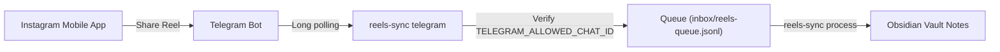

[Back to Documentation](README.md)

# Telegram Bot Setup

Guide for creating a private Telegram bot, retrieving your numeric chat ID, and running the `reels-sync telegram` capture listener.

## Overview

The Telegram bot provides a mobile capture inbox. Instead of manually copying Reel URLs into a terminal, share a Reel from the Instagram mobile app directly to your private Telegram bot.



---

## 1. Create a Bot with `@BotFather`

1. Open Telegram and start a chat with `@BotFather` (verified account).
2. Send `/newbot`.
3. Enter a display name for the bot (for example, `Reels Secretary`).
4. Enter a unique username ending in `bot` (for example, `my_reels_wiki_bot`).
5. Copy the HTTP API token returned by `@BotFather`.

> **Security:** Treat the bot token like a password. Never commit it to git or share it publicly; store it only in `.env` (which is ignored by `.gitignore`).

---

## 2. Get Your Numeric Chat ID

`reels-sync telegram` enforces single-user access. It refuses to start if `TELEGRAM_ALLOWED_CHAT_ID` is unset and silently ignores messages from any other chat ID.

1. Open Telegram and start a chat with `@userinfobot`.
2. Send `/start`.
3. Copy the numeric `Id` value from the reply (for example, `123456789`).

---

## 3. Configure `.env`

| Variable | Required | Description |
| :--- | :--- | :--- |
| `TELEGRAM_BOT_TOKEN` | Yes | Bot token issued by `@BotFather` |
| `TELEGRAM_ALLOWED_CHAT_ID` | Yes | Integer chat ID authorized to enqueue URLs |

You can configure these values in either of two ways:

- **Interactive setup**: Run the setup wizard and accept the Telegram bot prompt:

  ```bash
  reels-sync init
  ```

- **Manual edit**: Add the variables to `.env` in the repository root:

  ```env
  TELEGRAM_BOT_TOKEN=your_telegram_bot_token
  TELEGRAM_ALLOWED_CHAT_ID=123456789
  ```

---

## 4. Run and Test the Bot

Start the long-polling listener:

```bash
reels-sync telegram
```

Or invoke the dedicated entry point directly:

```bash
reels-wiki-telegram
```

To verify end-to-end capture:

1. Open a Reel in the Instagram mobile app, tap **Share**, and send it to your Telegram bot.
2. Check that the URL entered the queue:

   ```bash
   reels-sync stats
   ```

3. Process queued items into Obsidian notes:

   ```bash
   reels-sync process --limit 10
   ```

---

## 5. Operational Notes

- **Enqueue only**: `reels-sync telegram` only parses Instagram URLs and appends them to `inbox/reels-queue.jsonl`. Schedule periodic `reels-sync process --limit 10` runs via `cron` or macOS `launchd` to digest incoming links automatically.
- **Deduplication**: Shared URLs are normalized to 11-character shortcodes and checked against `sources/.reels_index.json`, so duplicate sends are ignored.
- **Token redaction**: Network error logs from the Telegram client automatically redact the bot token before writing output.
